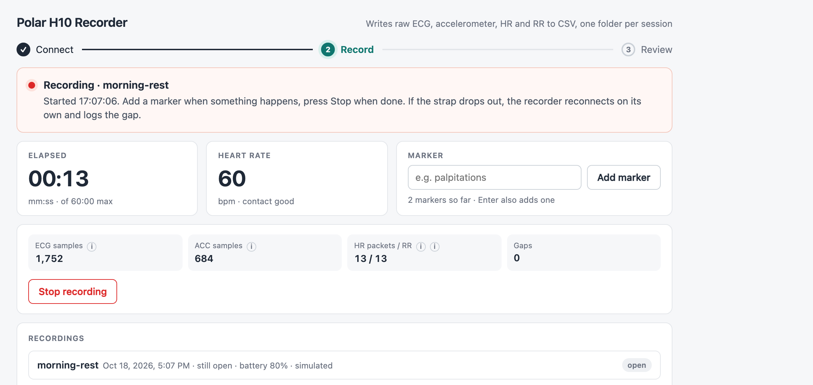

# Polar H10 Recorder

Records raw data from a Polar H10 chest strap over Bluetooth LE into plain CSV files, one
folder per session, so heart-rhythm analysis can be done later in a separate step. The
app is driven from a small web page on localhost; nothing leaves the computer.

Recorded per session: single-lead ECG (130 Hz), 3-axis accelerometer (50 Hz), heart
rate and RR intervals (about 1 Hz), battery level at start, timestamped markers, a gap
log and a metadata file with a QA summary.

## Status

Version 0.1.0. Recording, markers, gap logging and the quality checks have been
exercised on real hardware (H10 firmware 5.0.0). The test suite covers the file format
and the server without hardware. Only macOS has been tried. A session stops by itself
after one hour. There is no analysis built in. This is not a medical device and the
recordings are not diagnostic. Bug reports and pull requests are welcome. The code was
written with Claude Code under the author's direction; the design, the hardware testing
and the review are the author's.

## How this compares

Other tools record from the H10 too; this one exists because none of the ones below
writes all four streams with sensor-clock timestamps, a gap log and a quality summary into
plain files on a computer. Checked on 18 October 2026:

- [Polar Sensor Logger](https://play.google.com/store/apps/details?id=com.j_ware.polarsensorlogger)
  (Android, closed source): logs HR, RR, ECG and accelerometer from the H10 (also OH1 and
  Verity Sense) to files on the phone, with MQTT forwarding. The usual choice on Android.
- [ECG Logger for Polar H10](https://apps.apple.com/us/app/ecg-logger-for-polar-h10/id1595905348)
  (iOS, iPadOS, macOS on Apple silicon, Android; closed source): live view, ECG, HR and RR
  to CSV, PDF export; ECG recording and PDF export are in-app purchases.
- [polar-h10-ecg-viewer](https://github.com/RGreinacher/polar-h10-ecg-viewer) (Python, MIT):
  live 130 Hz plot with R-peaks and ECG-only CSV recording; per-sample times are
  back-calculated from packet arrival, with the raw Polar timestamp stored alongside.
- [bleakheart](https://github.com/fsmeraldi/bleakheart) (Python library, MPL-2.0): delivers
  HR, RR, ECG, accelerometer and Verity PPG to asyncio queues or callbacks. A building
  block rather than a recorder; it writes no files.

What this recorder does differently: one folder per session with ECG, accelerometer, HR
and RR together; per-sample timestamps derived from the strap's own clock; a log of
Bluetooth dropouts and automatic reconnect while recording; a per-session quality
summary (rail saturation, contact lost, no beats); timestamped markers; everything on the
computer, no phone and no account. What it does not do: no live trace, no analysis, no
phone app, and only macOS has been tested.

## Requirements

- macOS (tested on macOS 26 / Apple silicon). The Bluetooth library is cross-platform
  but only macOS has been tested.
- Polar H10 with firmware 3.0.35 or newer (ECG streaming).
- Python 3.12 and [uv](https://docs.astral.sh/uv/).

## Setup and start

```bash
./run.sh
```

The first run creates `.venv/`, installs the pinned dependencies and opens
`http://127.0.0.1:8765` in your browser. Later runs start in a second or two.
Stop the app with Ctrl-C in the terminal (an open recording is closed cleanly first).

Options: `./run.sh --port 9000`, `./run.sh --no-browser`, `./run.sh --fake` (see Development).

**Run it from Terminal (or iTerm), not from inside another app.** macOS ties the
Bluetooth permission to the app that launched the process. On the first scan macOS asks
whether Terminal may use Bluetooth; allow it. If the process is launched from an app
without a Bluetooth usage description, macOS kills it the moment it touches Bluetooth
(see Troubleshooting).

## What you see



The page walks you through three steps and always says what to do next:

1. **Connect.** Wear the strap with moistened electrodes and make sure it is not connected
   to Polar Flow, a watch or another app (a busy H10 stops advertising). Press **Scan for
   strap**. With one strap in range the page connects by itself; with several, pick yours.
   The banner then shows firmware, battery and whether ECG is available.
2. **Record.** Optional session label, then **Start recording**. While recording the page
   shows elapsed time, heart rate and sensor contact, and four small tiles with sample
   counts and effective rates for ECG, accelerometer and HR, plus the gap count. A tile
   turns amber when its stream falls behind. The ECG tile also turns amber with "saturated"
   when the signal sits at full scale, and the heart-rate caption shows "no beats" after five
   seconds without RR intervals. Type a note and press Enter or **Add marker**
   to timestamp a moment. If the strap drops out, the recorder reconnects on its own and
   logs the gap. **Stop recording** ends the session.
3. **Review.** The new session opens in the Recordings list with a verdict per signal
   (ok when the effective rate is within 2 % of expected for ECG and accelerometer, 0.8 to 1.2 Hz for HR, and there are no gaps), the
   markers, a 10-second ECG excerpt viewer on ECG-paper grid, and a link to the folder in
   Finder. The verdicts also flag a saturated ECG (a second with at least half its samples at the
   converter's full scale, which means a loose strap or dry electrodes) and off-body time (lost
   sensor contact, or 5 s or more without RR intervals).
   Earlier sessions are listed below it. Each listed session can be opened to see its markers
   (with a Show ECG button that jumps to the moment), to page through the ECG ten seconds at a
   time, and to delete the recording after a confirmation; deleting removes the folder from disk
   and cannot be undone.

Output folder: defaults to `recordings/` inside this project folder (gitignored). Change it with **Change folder** at the bottom of the Recordings card; the
choice is stored in `config.json`.

## Files per session

Folder name: `recordings/<YYYY-MM-DD_HH-MM-SS>[_<label>]/` (local time). All CSVs have a
header row, comma separators, UTF-8.

| File | Columns | Notes |
|---|---|---|
| `ecg.csv` | `host_time_utc_ns, sensor_time_ns, ecg_uv` | one row per sample, 130 Hz, ECG in **microvolts** (signed integer) |
| `acc.csv` | `host_time_utc_ns, sensor_time_ns, acc_x_mg, acc_y_mg, acc_z_mg` | one row per sample, 50 Hz, **milli-g** (signed integer), ±4 g range |
| `hr.csv` | `host_time_utc_ns, hr_bpm, sensor_contact` | one row per HR notification (about 1 Hz); `sensor_contact` is 1, 0, or empty if not reported |
| `rr.csv` | `host_time_utc_ns, rr_ms` | one row per RR interval in milliseconds (3 decimals); the H10 sends RR in 1/1024 s units |
| `markers.csv` | `host_time_utc_ns, note` | one row per marker |
| `gaps.csv` | `signal, start_host_time_utc_ns, end_host_time_utc_ns, duration_ms, reason` | see Gaps |
| `metadata.json` | | device, firmware, battery, stream settings, start/end, clock offsets, library versions, QA |

`host_time_utc_ns`: Unix time in nanoseconds, UTC, from the computer clock.
`sensor_time_ns`: the H10's own clock in nanoseconds since 2000-01-01 00:00:00 UTC,
exactly as sent by the strap. HR and RR rows have no sensor time (the standard
heart-rate characteristic carries none).

A one-hour session is about 20 MB for ECG and 5 MB for ACC.

### Timestamps: how per-sample times are derived

Each Polar Measurement Data (PMD) frame carries one 64-bit sensor timestamp that refers
to the **last** sample in the frame (ECG frames carry 73 samples, ACC frames 36). For a
frame with `n` samples at rate `fs`, sample `i` (0-based) gets

```
sensor_time_ns = frame_ts - round((n - 1 - i) * 1e9 / fs)
host_time_utc_ns = sensor_time_ns + 946684800000000000 + offset_ns
```

`offset_ns` is `time.time_ns() - frame_unix_ns` measured once on the first frame after
each connect or reconnect and stored in `metadata.json` under `clock_offsets`. Within
one connection the host time therefore follows the sensor clock exactly and does not
jitter with Bluetooth delivery. After a reconnect the offset is measured again, so the
sensor clock may jump while host time stays continuous. Note that the offset includes
the Bluetooth delivery latency of that first frame (a few tens of milliseconds); host
times are consistent within a session but not absolute to that precision.

HR and RR rows carry the arrival time of the notification. To place an RR interval on
the ECG, use the ECG itself; the RR series is a convenience from the strap's own beat
detector.

### Gaps

Two kinds of rows in `gaps.csv`:

- `disconnect`: the Bluetooth link dropped. Start is the host time of the last sample
  received for that signal, end is the first sample after the streams resumed. One row
  per signal (`ecg`, `acc`, `hr`). If the session is stopped while still disconnected,
  the gap ends at the stop time.
- `frame_gap` (ECG and ACC only): consecutive frame timestamps from the strap differ by
  more than 1.5 times the expected frame interval while connected, meaning the strap
  dropped a frame without disconnecting. Start is the last sample before, end the first
  sample after.

On a drop the app reconnects with backoff (1, 2, 4, 8, then 10 s) for up to five minutes,
then stops the session and keeps everything recorded so far. Files are flushed every
second, on every gap and marker, and synced on stop, so a crash loses at most a second.

### QA summary (in `metadata.json` under `qa` and shown on the page)

`duration_s`; per signal `sample_count`, `expected_rate_hz`, `effective_rate_hz`
(samples over the span from first to last sample, minus that signal's gap time),
`first_sample_s` and `last_sample_s` (seconds after session start), `gap_count`,
`gap_total_s`; `marker_count`; `rr_count`. A clean ECG recording shows an effective rate
within about ±0.5 Hz of 130 (the H10 clock runs about 0.15 % fast, so 130.2 is normal).
Streams typically start 0.2 to 6 s after Start, and the last frame buffered in the strap
(up to 0.56 s) is not delivered on Stop; both are visible in `first_sample_s` and
`last_sample_s` rather than in the rate.

`quality` (since October 2026): `ecg_rail_uv` (19364, the full-scale value),
`ecg_saturated_s` (seconds in which at least half the ECG samples sat at the rail: a loose
strap, dry electrodes or no body), `contact_lost_s` (HR packets whose sensor-contact flag
was 0), `rr_silence_s` (the longest stretch without RR intervals, excluding logged
Bluetooth gaps). These are the fastest signs that the strap was off; the `sensor_contact`
flag itself lags removal by several seconds.

Note that taking the strap off does **not** drop the Bluetooth link; the H10 keeps
streaming (noise) and reports `sensor_contact = 0` in `hr.csv`. To find off-body periods,
look at `qa.quality` first; the `sensor_contact` column in `hr.csv` confirms it but lags. A real link loss is logged as a `disconnect` gap.

## Troubleshooting

**"No Polar H10 found."** Wear the strap with moist electrodes, close Polar Flow and
disconnect any watch (a connected H10 stops advertising), and check
System Settings › Privacy & Security › Bluetooth includes Terminal.

**The strap is on and wet but nothing finds it, not even Polar Flow.** A phone that paired
with it earlier (Polar Flow, Polar Beat, or another app) grabs the strap the moment it powers
up, and a connected H10 stops advertising. Turn off Bluetooth on the phone, or forget the
sensor there, and scan again.

**The app quits during Scan, or "This app has crashed because it attempted to access
privacy-sensitive data without a usage description".** macOS aborts processes that use
Bluetooth from an app bundle without `NSBluetoothAlwaysUsageDescription`. Two cases:

- Launched from Terminal or iTerm: normal; macOS shows a permission prompt the first
  time. Allow it.
- Launched from another app (an IDE, an automation, an AI coding tool): macOS checks the
  *launching* app's bundle and there is nothing this project can do about it. Start
  `./run.sh` from Terminal instead; the same server that crashes on Scan when started
  from a helper process works when started from Terminal.

**"This H10 does not offer ECG streaming."** Firmware is older than 3.0.35. Update in
the Polar Flow app (Devices › H10 › Sync / firmware update).

**Reconnecting for a long time.** The strap only reconnects while it advertises, which
requires skin contact with moist electrodes. Put it back on; the log in `recorder.log`
shows each attempt.

**Where things are:** `recorder.log` (app log, in this folder), `config.json` (output
folder), `recordings/` (sessions).

## Library choice

Bluetooth via [bleak](https://github.com/hbldh/bleak); PMD frame parsing and stream
settings via [polar-python](https://github.com/zHElEARN/polar-python). polar-python was
chosen over bleakheart because it is more actively maintained (April 2026 vs
October 2025) and has typed models and tests. Neither library provides reconnect,
per-sample timestamps, battery/firmware reads or a correct heart-rate flags parser, so
those live in `polar_recorder/ble.py` and `polar_recorder/recorder.py`. PMD frame
decoding is about 60 lines and could replace polar-python without changing the design.

## Development

`./run.sh --fake` (or `POLAR_FAKE=1 ./run.sh`) starts the recorder with a simulated strap:
no Bluetooth, a synthetic 60 bpm ECG, resting accelerometer, HR and RR once a second, and
one 3-second dropout 20 seconds after Start so the gap path can be seen. Use it to work on
the page or to take screenshots. Sessions recorded this way look like real ones in the
Recordings list; delete them afterwards.

`./run.sh --requalify` adds the quality block (saturation, contact, RR silence) to sessions recorded before it existed; `--requalify FOLDER` does the same for another folder.

```bash
uv sync                 # includes dev tools
uv run pytest -q        # unit tests (no hardware needed)
```

Layout: `polar_recorder/ble.py` (Bluetooth), `polar_recorder/recorder.py` (files,
timestamps, gaps, QA), `polar_recorder/server.py` (FastAPI endpoints + websocket status),
`polar_recorder/static/index.html` (the page).

## License

MIT, see [LICENSE](LICENSE).
